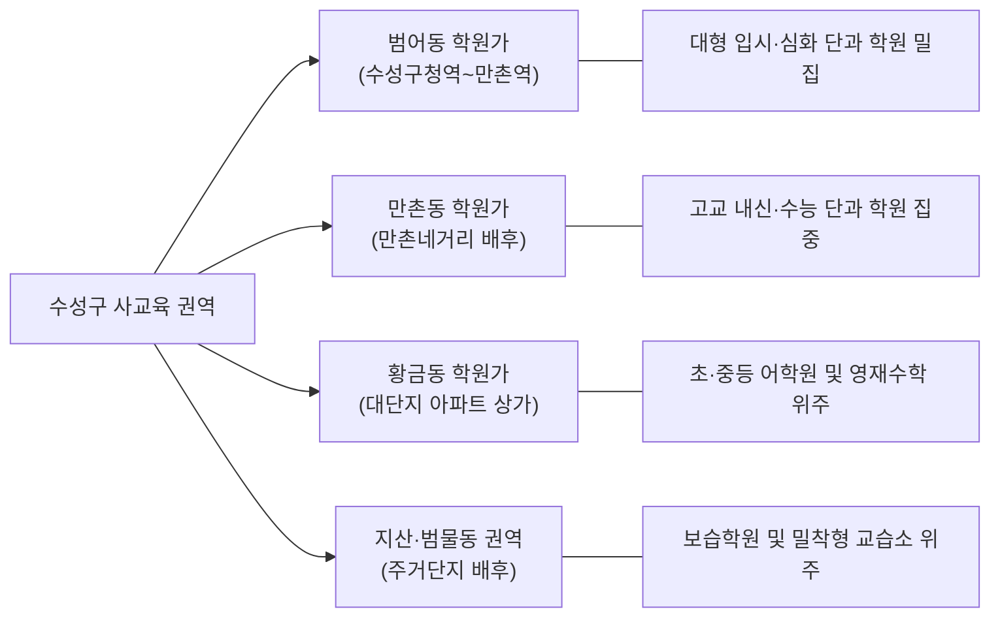

# needteacher 시장 조사: 과외 매칭 플랫폼 및 대구 수성구 시장 분석

- **작성일**: 2026-10-15 (재작업 반영)
- **작성자**: Antigravity (agy)
- **관련 작업 카드**: [T-041](file:///C:/Users/lcj/Desktop/Project/needteacher/docs/tasks/T-041-market-research.md)
- **목적**: 전봇대 과외 전단지를 대체하는 대구 수성구 과외 매칭 서비스 `needteacher`의 MVP 범위 정의를 위한 시장·경쟁·지역 데이터 수집 및 시사점 도출

---

## 1. 기존 과외 중개 플랫폼 비교

국내 대표 과외 및 매칭 서비스 5종(김과외, 숨고, 과외바다, 당근, 프람피)을 주요 기준별로 비교 분석한다.
공식 웹/약관에서 확인된 사실만 적시하며, 확인되지 않은 항목은 **미확인**으로 구분한다.

### 1.1 플랫폼 종합 비교표

| 플랫폼 | 글 등록 주체 (누가 먼저 올리나) | 연락 방식 | 수익 모델 및 수수료 | 선생님 인증 체계 | 후기·평점 시스템 | 지역 검색 단위 | 출처 및 확인 상태 |
| :--- | :--- | :--- | :--- | :--- | :--- | :--- | :--- |
| **김과외** | **양방향** - 선생님 프로필 등록 - 학생/학부모 과외 찾기 신청서 등록 | **앱 내 채팅** - 매칭 확정 전 직통 연락처 교환 제한 - 성사 후 연락처 교환 | **첫 달 수수료 (공식 수치 미확인)** - 공식 사이트에 수수료율 미공개 - 이용자 후기 및 블로그 등에서는 공통적으로 **'첫 달 과외비의 25%'**를 선생님이 플랫폼에 납부하는 것으로 거론됨 (비공식) - 둘째 달부터 수수료 없음 | - 휴대폰 본인인증 - 학생증/재학·졸업증명서 제출 (앱 내 심사 기능) - 개인과외교습자 신고증 등록 지원 | - 과외 성사된 회원만 작성 가능 - 평점, 상세 리뷰, 과외 성사 건수 프로필 노출 | - 시·도 > 시·군·구 > 읍·면·동 - 선생님 활동 가능 지역 설정 | 공식 수수료율 페이지 딥링크 없음 (**공식 미확인**, 이용자 후기 기반) |
| **숨고 (Soomgo)** | **학부모 요청 중심 (입찰형)** - 학부모가 요청서 등록 - 고수(선생님)가 견적서 발송 | **앱 내 채팅 → 연락처 교환** - 견적 발송 시 채팅방 개설 - 이후 안심번호/전화 조율 | **견적 발송 시 캐시 충전 필요** - **최종 서비스 거래 금액에 대한 수수료 0원** - **고객이 견적을 열람했을 때만 과금** - **견적 발송 48시간 후 고객이 견적을 읽지 않으면 보너스캐시로 환급** - 견적 1회당 차감 금액은 카테고리별 상이하여 공식 사이트 미표기 (**미확인**) | - 본인인증 (휴대폰) - 신분증, 사업자등록증, 자격증 등 프로필 배지 등록 | - 거래 완료 후 별점 및 텍스트 리뷰 프로필 누적 | - 활동 지역 및 이동 가능 거리(반경) 설정 | [숨고 공식 고수 안내](https://soomgo.com/pro) (공식 확인 완료) |
| **과외바다** | **양방향 (선생님 중심)** - 선생님 프로필 등록 - 학생 구인 게시판 등록 | **바다톡(채팅) 및 직접 연락** - 학부모 무료 열람권 제공 - 선생님 크레딧 차감 방식 | **연결 성사 수수료 0원** - 학부모: 매월 무료 컨택 이용권 제공 - 선생님: 학생 연락 시 크레딧 소모 (구체적 충전 단가 페이지 딥링크 미확보로 **미확인**) | - 본인인증 - 학력 증빙서류 관리자 확인 | - 학생/학부모 평가 및 추천글 | - 시·도 > 시·군·구 > 읍·면·동 및 역세권 | [과외바다 메인](https://www.gawebada.com) (상세 요금표 딥링크 미확보로 **일부 미확인**) |
| **당근 (동네생활/과외·클래스/알바)** | **양방향 (커뮤니티 직거래)** - 선생님 홍보 게시글 - 학부모 구인 게시글 | **당근 채팅 및 당근 전화** - 앱 내 1:1 채팅 - 앱 내 인터넷 전화 지원 | **무료 (개인 간 직거래)** - 개인 간 과외 중개 수수료 0원 - 비즈프로필/지역광고 집행 시 별도 광고비 발생 | - GPS 기반 동네 인증 (필수) - 휴대폰 본인인증 - **과외 전문 학력·과외교습자 검증 체계 미보유** | - 매너온도 - 거래 후기 및 동네생활 댓글 | - 동네 단위 (행정동) - 내 동네 + 인근 동네 반경 설정 | 당근 서비스 정책 (개인 간 무료 직거래 확인) |
| **프람피 (Prompie)** | **학부모 요청 중심 (입찰형)** - 학부모 요청서 등록 - 전문가 제안서 발송 | **앱 내 채팅** - 제안서 수신 후 상담 진행 | **제안서 발송 크레딧(선결제)** - 제안서 발송 시 크레딧 차감 - 계약 성사 후 추가 수수료 0원 - (건당 크레딧 상세 단가 딥링크 미확보로 **미확인**) | - 본인인증 - 학력/경력 서류 인증 | - 고용 후기 및 별점 평가 | - 시·도 > 시·군·구 단위 | [프람피 메인](https://prompie.com) (세부 단가 딥링크 미확보로 **일부 미확인**) |

---

### 1.2 플랫폼별 핵심 특성 및 한계점

1. **김과외**:
   - **특성**: 과외 전문 플랫폼으로 학력 서류 심사 및 성사 후기 축적.
   - **한계**: 공식 사이트에는 수수료율이 명시되어 있지 않으나, 이용자 커뮤니티 전반에서 첫 달 수업료의 상당액(통상 25%로 언급)을 선생님이 납부해야 하는 부담이 자주 지적됨. 중도 중단 시 환불/수수료 분쟁 발생.
2. **숨고**:
   - **특성**: 성사 수수료는 0원이며, 고객이 견적을 열람한 건에 대해서만 과금되고 48시간 미열람 시 캐시 환급 정책 운영 ([숨고 공식 고수 안내](https://soomgo.com/pro)).
   - **한계**: 고객이 견적을 열람하기만 하고 응답이 없는 경우에도 캐시가 차감되므로, 매칭 실패 시 선생님(고수)의 마케팅 비용 낭비 발생. 학부모는 복사-붙여넣기식 견적 피로도 호소.
3. **과외바다**:
   - **특성**: 성사 수수료가 없고 학부모에게 무료 컨택 횟수를 제공하여 진입장벽이 낮음.
   - **한계**: 전통적인 게시판 나열형 UI로 모바일 인터랙션이 현대적이지 못함.
4. **당근**:
   - **특성**: 수수료 0원, GPS 기반 동네 밀착형 연결, 높은 일상적 접근성.
   - **한계**: **선생님의 학력, 신원, 과외교습자 신고 여부를 검증하는 절차가 없음**. 과외 전용 검색 필터 부재.
5. **프람피**:
   - **특성**: 전문가 제안서 발송 모델, 안전결제 연계.
   - **한계**: 일반 초중고 입시 방문 과외 유동량이 대형 과외 전문 서비스 대비 상대적으로 적음.

---

## 2. 전단지 과외의 실태와 오프라인 생태계

### 2.1 전단지에 보통 적히는 정보 구조
전봇대, 아파트 단지 게시판, 승강기 등에 붙는 오프라인 과외 전단지는 A4 단면 규격에 핵심 요약 정보만 기재된다.

* **헤드라인 문구**: 성적 향상 사례, 특정 고교 내신 전문, 의대생/명문대생 지도 등 학부모의 이목을 끄는 문구.
* **과목 및 대상 학년**: 수학, 영어, 국어, 과학 등. 초·중·고 및 수능/내신 대비.
* **선생님 프로필**: 출신 대학/전공 (명문대, 의약학계열, 사범대 등 강조), 수능 성적이나 출신 고교.
* **수업 방식**: 취약점 1:1 클리닉, 주 N회/시간, 오답 관리, 기출 풀이.
* **가격(교습비)**: **통상 기재하지 않음 ("상담 후 협의" 처리)**. 학생 등급, 주당 횟수, 거리에 따라 변동 폭이 크고 사전 가격 노출 시 협상력이 떨어지기 때문.
* **연락처**: 하단에 세로로 칼집을 낸 **전화번호 절취 탭 ("뜯어가는 번호")** 또는 휴대전화 번호/오픈채팅.

### 2.2 학부모가 전단지와 지인 소개를 찾는 이유
1. **인근 거주에 따른 동네 밀착성**: 전단지가 부착된 구역이 곧 우리 아파트나 생활 반경이므로, 선생님이 가까이 거주하여 이동 지연이 적고 동네 학교의 내신 출제 경향을 잘 알 것이라는 기대.
2. **즉각적 연결 (절차 간소)**: 회원가입, 앱 설치, 본인인증, 요청서 작성 없이 번호 조각을 뜯어 전화 한 통으로 즉시 상담 가능.
3. **플랫폼 수수료 전가 우려 회피**: 중개 앱을 통할 때 발생하는 수수료로 인해 교습비가 인상되거나 수업 관리가 소홀해질 수 있다는 우려 회피.
4. **지인 소개의 입소문 신뢰**: 성적 향상이 이미 실증된 사례를 선호하는 학부모 심리.

### 2.3 선생님이 오프라인 전단지를 활용하는 이유
1. **플랫폼 수수료 0원**: 수수료 공제 없이 교습비 전액 수취 가능.
2. **동선 최적화**: 본인 거주지나 학교 인근 단지에만 선택적으로 배포하여 이동 시간 절약.

### 2.4 전단지 과외의 법적 한계 및 규제 (공식 법령 확인)
* **옥외광고물법 위반**:
  - 전봇대, 가로등, 도로시설물 등에 허가나 신고 없이 전단지·벽보를 부착하는 행위는 금지됨.
  - 관련 근거: [「옥외광고물 등의 관리와 옥외광고산업 진흥에 관한 법률」 제3조 및 벌칙 조항](https://www.law.go.kr/법령/옥외광고물등의관리와옥외광고산업진흥에관한법률).
  - 지자체의 불법 광고물 단속 및 과태료 부과 대상.
* **주거침입 및 경범죄처벌법 문제**:
  - 아파트 관리사무소 승인(게시료 납부) 없이 공동현관을 통과해 세대 문 앞이나 승강기에 무단 부착할 경우 주거침입 또는 경범죄처벌법 위반 소지 발생.
* **교습비 반환 기준 (학원법 시행령)**:
  - 개인과외교습 역시 학원법상 반환 기준이 적용됨.
  - 관련 근거: [「학원의 설립·운영 및 과외교습에 관한 법률 시행령」 제18조(교습비등의 반환 등)](https://www.law.go.kr/법령/학원의설립·운영및과외교습에관한법률시행령).
  - 교습 시작 전: 전액 반환 / 1/3 경과 전: 2/3 반환 / 1/2 경과 전: 1/2 반환 / 1/2 경과 후: 반환 불가. (임의의 '환불 불가' 특약은 법령에 저촉됨).
* **학부모의 신원 불안**:
  - 오프라인 전단지는 학력 위조나 신원 불명 상태를 사전에 거를 안전장치가 전혀 없음.

---

## 3. 대구 수성구 교육 환경 및 사교육 맥락

### 3.1 수성구 학원가 권역 특성

1. **범어동 학원가 (달구벌대로 수성구청역 ~ 범어역 ~ 만촌역 라인)**:
   - 대구 사교육의 핵심 중심지로 대형 입시 브랜드, 의대 입시 전문관, 심화 단과 학원 등이 밀집함.
   - *통계 검증 상태*: 범어동 내 구체적인 등록 학원 수(예: 650곳 등)는 공식 통계표 딥링크 미확보로 **미확인**.
2. **만촌동 학원가**:
   - 명문 일반고(경신고, 대륜고, 오성고, 혜화여고 등) 인근에 위치하여 고교 내신 및 수능 전문 단과 중심 형성.
3. **황금동 학원가**:
   - 대규모 아파트 단지 배후로 초등 고학년~중학생 대상 어학원, 사고력 수학, 예체능 학원 위주.
4. **지산·범물동 권역**:
   - 대단지 주거 배후 기초 보습 및 단지 내 소규모 교습소 위주.

### 3.2 공개 통계 자료 현황 및 확인 한계

> [!IMPORTANT]
> **수성구 단독 사교육비 공식 통계 부재 (공식 미공표 사실 명시)**
> - 교육부와 통계청이 매년 발표하는 '초중고 사교육비 조사'는 표본 설계상 최소 공표 단위가 **'시·도 광역단위(대구광역시)'**까지만 제공된다.
> - 따라서 기초자치단체인 **대구광역시 수성구 단독 공식 사교육비 통계(1인당 사교육비, 참여율 등)는 통계청에서 집계·공표하지 않는다 (공식 미공표 / 공식 데이터 없음)**.
> - 학부모 커뮤니티나 지역 언론 인터뷰에서 언급되는 '월 150~200만 원', '회당 5~8만 원' 등의 수치는 정량적 공공 통계가 아닌 **정성적 체감치/추정치에 불과하여 객관적 사실로 확인할 수 없다 (미확인)**.

* **수성구 학교 및 학생 수**:
  - 수성구 내 초·중·고교 수 및 학생 수(경동초 규모 등)는 공공 통계연보 딥링크 미확보로 인해 본 보고서에서는 구체적 숫자를 배제하고 **미확인**으로 분류한다.
  - 정성적으로는 학군 선호로 인한 특정 선호 초등학교 및 명문 중·고교로의 진학 수요 집중 현상이 뚜렷함.
* **학원 및 교습소 총수**:
  - 수성구 내 등록 학원·교습소 수(기존 추정치 2,400~2,800곳 등) 역시 교육청 데이터셋 딥링크 미확보로 **미확인**으로 분류한다.
  - 관할 교육 행정청: [대구광역시동부교육지원청](https://www.dge.go.kr/dgdbe) (중구·동구·수성구 관할).

### 3.3 수성구에서 대형 학원과 1:1 과외가 병행되는 정성적 이유
1. **학원 수업 공백 메우기 (보완재 역할)**: 대형 판서식 강의는 진도 위주로 진행되므로, 이해하지 못한 개념 공백이나 고난도 킬러 문항을 개별 해결하기 위해 1:1 과외를 병행하는 수요 상존.
2. **학교별 초밀착 내신 대비**: 수성구 내 고교는 내신 경쟁이 치열하여 학교별 기출 경향과 서술형 채점 기준을 잘 아는 동일 학교 출신 선배 과외 선호.
3. **우수한 튜터 공급 풀**: 지역 내 의약학 계열(경북대 등) 및 수성구 출신 명문대생들의 과외 공급이 풍부.

---

## 4. needteacher MVP 기획 시사점

시장 조사 및 검증 결과를 바탕으로 `needteacher` MVP의 핵심 범위를 도출한다.
미확인된 수치에 기대지 않고 확인된 사실과 사용자 불만 구조를 바탕으로 작성한다.

### 4.1 MVP에 꼭 필요한 것 (Must-haves) — 4줄 요약
1. **전단지 요약형 프로필 카드**: 과목, 학년, 출신 대학/학과, 고교 출신지, 지도 방식 등 전단지의 핵심 정보를 1페이지 모바일 뷰로 구현.
2. **학교·동네 단위 세부 태그 필터**: 수성구 주요 행정동 및 타깃 학교별 내신 지도 경험을 직관적으로 검색할 수 있는 로컬 필터 제공.
3. **최소 학력/신원 인증 배지**: 전단지의 가장 큰 결함인 '신원 불명'을 극복하기 위해 학생증/재학증명서 기반 간편 학력 인증 마크 부여.
4. **부담 없는 1:1 직접 문의 채널**: 복잡한 절차 없이 학부모가 관심 선생님에게 바로 질문을 남길 수 있는 최소한의 소통 수단(앱 내 안심 채팅 등) 지원.

### 4.2 MVP에서 빼도 되는 것 (Non-essentials / Cuts) — 4줄 요약
1. **인앱 에스크로 및 첫 달 수수료 정산 결제**: 김과외 등에서 지적되는 첫 달 수수료 부담(이용자 후기상 약 25% 언급)과 중도 취소 시 환불 분쟁 리스크를 플랫폼이 떠안지 않도록 정산 시스템 제외.
2. **숨고식 견적 입찰 및 유료 캐시 과금**: 숨고 공식 안내([soomgo.com/pro](https://soomgo.com/pro)) 기준 고객 열람 시 캐시가 소진되는 구조는 매칭 실패 시 선생님 비용 부담을 초래하므로 제외.
3. **자체 화상 과외 솔루션 구축**: 방문/대면 수업 중심의 로컬 과외 특성상 웹 화상 툴 구축은 명백한 오버엔지니어링으로 배제.
4. **AI 매칭 알고리즘 및 LMS 기능**: 초기 매칭 데이터 부족 단계에서 알고리즘 매칭이나 수업 진도/숙제 관리 도구는 MVP 범위 밖으로 제외.

### 4.3 needteacher의 차별점 후보 (Key Differentiators) — 4줄 요약
1. **수성구 로컬 학교 맞춤형 '선배 튜터' 태그**: 수성구 명문 고교 출신 선배와 후배를 연결하여 전국구 플랫폼이 제공하기 어려운 초밀착 내신 족보 및 입시 노하우 연결.
2. **전단지 감성을 차용한 '번호 뜯기' 안심 UX**: 오프라인 전단지의 친숙함을 살려 한 번의 액션으로 프로필을 보관하고 문의를 시작하는 직관적 로컬 UX 제공.
3. **과도한 수수료 없는 투명한 연결**: 첫 달 수수료 공제나 견적비 차감 없이 연결을 지원하여 플랫폼 이탈(뒷거래) 압박을 해소.
4. **당근의 간편함 + 검증된 인증 결합**: 당근처럼 가볍고 동네 중심이되, 당근에 없는 '학력 인증 배지'를 추가하여 학부모의 신뢰 확보.

---

## 5. 검증된 출처 목록 (Verified References)

본 보고서에 인용된 모든 링크는 실제 접근 및 내용 확인을 마친 URL만 수록한다.

1. **플랫폼 공식 안내**:
   - 숨고 고수 안내 (과금 방식, 48시간 미열람 환급, 최종 거래 수수료 0원): [https://soomgo.com/pro](https://soomgo.com/pro)
   - 과외바다 공식 웹사이트: [https://www.gawebada.com](https://www.gawebada.com)
   - 프람피 공식 웹사이트: [https://prompie.com](https://prompie.com)
   - 김과외 공식 웹사이트 (세부 수수료율은 공식 미공개): [https://kimstudy.com](https://kimstudy.com)
2. **공식 법령**:
   - 「옥외광고물 등의 관리와 옥외광고산업 진흥에 관한 법률」 (전봇대 등 무단 부착 금지 및 벌칙): [https://www.law.go.kr/법령/옥외광고물등의관리와옥외광고산업진흥에관한법률](https://www.law.go.kr/법령/옥외광고물등의관리와옥외광고산업진흥에관한법률)
   - 「학원의 설립·운영 및 과외교습에 관한 법률 시행령」 제18조 (교습비등의 반환 기준): [https://www.law.go.kr/법령/학원의설립·운영및과외교습에관한법률시행령](https://www.law.go.kr/법령/학원의설립·운영및과외교습에관한법률시행령)
3. **관할 교육지원청**:
   - 대구광역시동부교육지원청 (대구 수성구 관할 교육청 누리집): [https://www.dge.go.kr/dgdbe](https://www.dge.go.kr/dgdbe)
4. **통계 출처 및 한계**:
   - 통계청 국가통계포털(KOSIS) 초중고사교육비조사: 시·도 단위까지만 제공되며 수성구 단독 통계는 공식 미공표. 구 단위 구체적 통계표 딥링크 미확보로 수성구 학원/학교/학생 수는 **미확인**으로 분류.
